# 5. Arquitectura empresarial — EPS AGUAS DEL SUR S.A. (Empresa 08 · Grupo 08)

> Fuentes: `arquitectura-actual.md` y `FICHA.md` de la organización, `AR01_principios.md`, `AR02_entidades.csv`, `AR03_brechas.csv` y el modelo [`arquitectura.archimate`](arquitectura.archimate) (ArchiMate 3.2, Archi 5.10). Clasificación: **Restringida**.

## 5.1 Principios de arquitectura

Detalle completo, con los cinco campos de cada uno, en [`AR01_principios.md`](AR01_principios.md).

| N.º | Principio | Declaración resumida | Trazabilidad al diagnóstico |
|---|---|---|---|
| P1 | Dato único con dueño designado | Cada entidad tiene una sola fuente autoritativa y un dueño por cargo | 5 de 8 entidades sin fuente autoritativa; 11 200 conexiones facturadas por estimación |
| P2 | Trazabilidad del ciclo comercial ante el regulador | Todo paso lectura–facturación–cobranza queda registrado de forma inmutable | Incidente G de la FICHA; riesgo H-2 |
| P3 | Integración por servicios publicados | Se prohíbe el archivo plano sin trazabilidad y el paso manual entre sistemas | 4 integraciones: 2 por archivo plano, 1 manual, 1 inexistente |
| P4 | Seguridad desde el diseño con separación OT/IT | La red industrial se segrega de la administrativa | Riesgo H-1; switches compartidos desde 2023 |
| P5 | Cumplimiento normativo no negociable | Las obligaciones exigibles prevalecen sobre lo discrecional | D.Leg. 1412, D.S. 029-2021-PCM, R.M. 119-2018-PCM, Ley 29733 |
| P6 | Proporcionalidad y complejidad justificada | La solución es proporcional al problema y a la capacidad de TI | 6 personas en TI; S/ 1 080 000 (1.46 % de la facturación); 2 de 5 contratos vencidos |

## 5.2 Arquitectura actual (as-is)

### 5.2.1 Capa de negocio

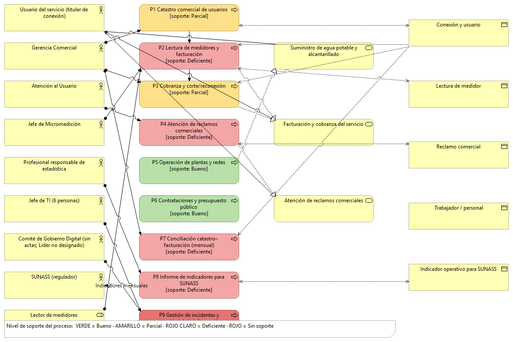

- **Actores:** usuario del servicio, Gerencia Comercial, Atención al Usuario, Jefe de Micromedición, profesional de estadística, Jefe de TI, SUNASS (regulador) y el Comité de Gobierno Digital (sin actas; Líder no designado).
- **Procesos (9):** P1 Catastro comercial · P2 Lectura y facturación · P3 Cobranza y corte/reconexión · P4 Atención de reclamos · P5 Operación de plantas y redes · P6 Contrataciones y presupuesto · P7 Conciliación catastro–facturación · P8 Informe de indicadores para SUNASS · P9 Gestión de incidentes y seguridad.
- **Servicios de negocio:** suministro de agua potable y alcantarillado · facturación y cobranza · atención de reclamos comerciales.
- P7, P8 y P9 no figuran en la cadena de valor de la ficha; se modelaron porque la organización los ejecuta sobre hojas de cálculo (P7, P8) o por correo (P9).

### 5.2.2 Capa de datos

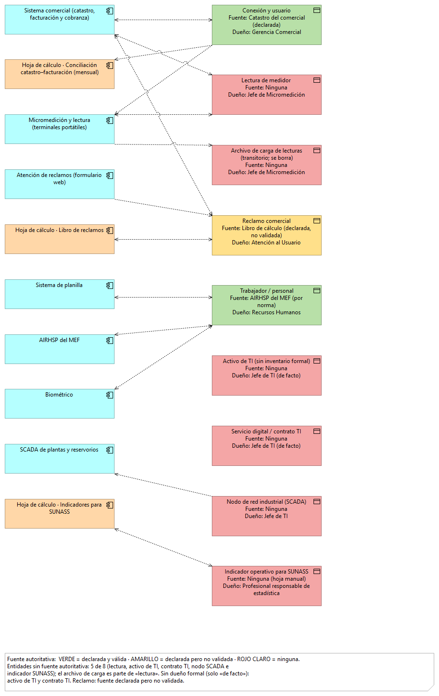

Detalle en [`AR02_entidades.csv`](AR02_entidades.csv).

| Entidad | Sistemas donde reside | Registros | Fuente autoritativa | Dueño (cargo) | Clasificación | Datos personales |
|---|---|---|---|---|---|---|
| Conexión y usuario | Catastro · Facturación · Lecturas · Reclamos | 86 000 · 86 000 · 84 100 · 4 800 | Catastro (declarada) | Gerencia Comercial | Confidencial | Sí |
| Lectura de medidor | Terminales · Archivo de carga · Facturación | 1 030 000 al año | **Ninguna** | Jefe de Micromedición | Interna | No |
| Reclamo comercial | Formulario · Libro · Comercial · SUNASS | 4 800 al año | Libro de cálculo (**no validada**) | Atención al Usuario | Confidencial | Sí |
| Trabajador | AIRHSP · Planilla · Biométrico | 312 · 312 · 370 | AIRHSP | Recursos Humanos | Restringida | Sí (sensibles) |
| Activo de TI | Sin inventario | — | **Ninguna** | Jefe de TI (de facto) | Interna | No |
| Servicio digital / contrato TI | Contratos | 5 (2 vencidos) | **Ninguna** | Jefe de TI (de facto) | Interna | No |
| Nodo de red industrial (SCADA) | Red industrial y administrativa | — | **Ninguna** | Jefe de TI | Restringida | No |
| Indicador operativo SUNASS | Hoja de cálculo · Informe | Sin versionado | **Ninguna** | Profesional de estadística | Confidencial | No |

**Entidades sin fuente autoritativa: 5 de 8.** Con fuente declarada pero no validada: 1 (reclamo). Con dueño solo «de facto»: 2 (activo de TI y contrato TI). Con datos personales: 3.

### 5.2.3 Capa de aplicación

- **Componentes (11):** sistema comercial · SCADA · micromedición y lectura · SIAF y patrimonio · atención de reclamos (formulario web) · sistema de planilla · AIRHSP · biométrico · y **tres hojas de cálculo modeladas como componentes**: conciliación catastro–facturación, libro de reclamos e indicadores para SUNASS.
- **Integraciones:** micromedición→comercial por archivo plano que no se conserva · comercial→SIAF por digitación manual · formulario→libro→comercial a mano · SCADA→nadie.

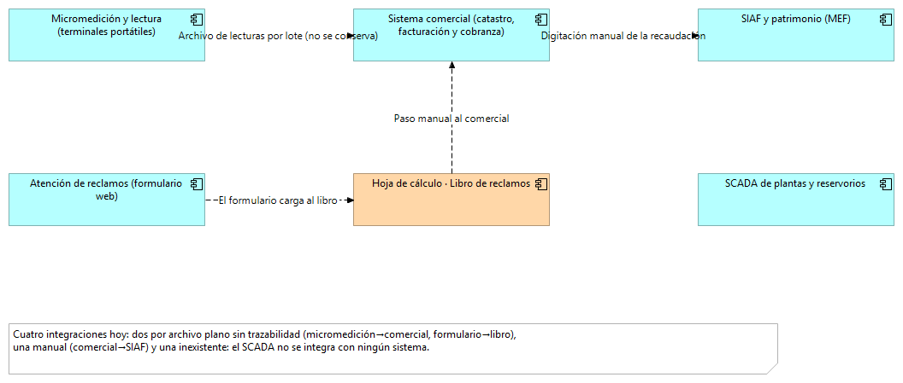

### 5.2.4 Capa de tecnología

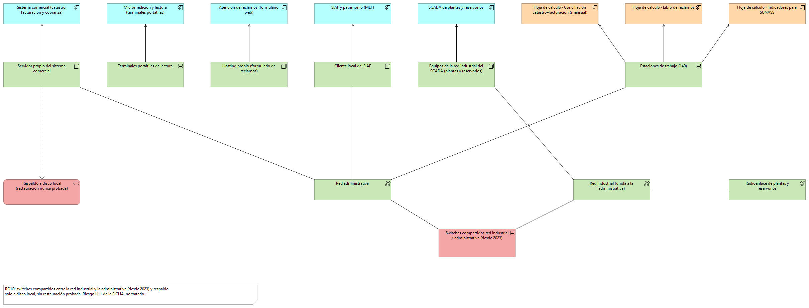

Servidor propio del sistema comercial · hosting propio del formulario de reclamos · terminales portátiles · cliente local del SIAF · 140 estaciones · equipos de la red industrial del SCADA · red administrativa, red industrial y radioenlace · **switches compartidos desde 2023** · respaldo solo a disco local, sin restauración probada.

### 5.2.5 Vista de cooperación proceso-aplicación

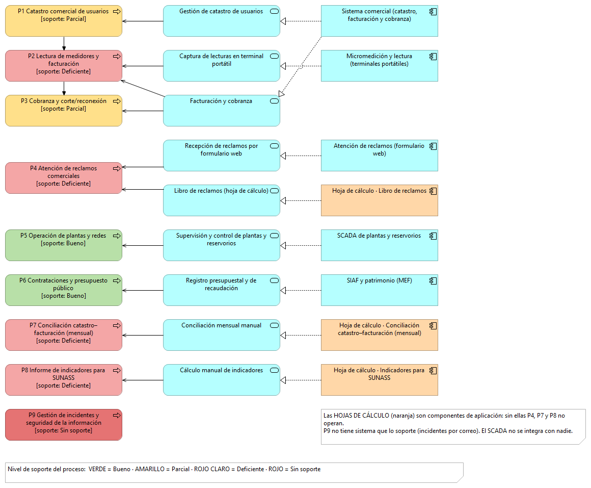

| Proceso | Sistema que lo soporta | Nivel |
|---|---|---|
| P1 Catastro comercial | Sistema comercial | Parcial (3 100 discrepancias) |
| P2 Lectura y facturación | Micromedición + comercial | **Deficiente** (11 200 estimadas; sin trazabilidad) |
| P3 Cobranza y corte/reconexión | Sistema comercial | Parcial (recaudación digitada en SIAF) |
| P4 Atención de reclamos | Formulario web + hoja de cálculo | **Deficiente** (sin soporte desde 2021) |
| P5 Operación de plantas y redes | SCADA | Bueno |
| P6 Contrataciones y presupuesto | SIAF y patrimonio | Bueno |
| P7 Conciliación catastro–facturación | Hoja de cálculo | **Deficiente** |
| P8 Indicadores para SUNASS | Hoja de cálculo | **Deficiente** |
| P9 Incidentes y seguridad | Correo (sin sistema) | **Sin soporte** |

**Procesos sin soporte o con soporte deficiente: 5 de 9.**

## 5.3 Arquitectura objetivo (to-be)

### 5.3.1 Derivación

| Insumo | Qué aporta a la arquitectura objetivo |
|---|---|
| Objetivo declarado para TI (FICHA A) | Segmentar la red industrial y dar trazabilidad al ciclo comercial → VLAN con firewall; API con registro inmutable |
| Incidente del periodo (FICHA G) | Conservar hash y marca de tiempo de cada lote de lecturas |
| Riesgos H-1, H-2, H-3 (FICHA H) | Segmentación OT/IT · registro del lote · gestión de reclamos con trazabilidad |
| Principios P1–P6 (AR01) | Dato único, interfaces publicadas, proporcionalidad |
| Marcos y normativa | COBIT 2019 (DSS02, DSS04, DSS05, APO12), D.Leg. 1412, D.S. 029-2021-PCM, R.M. 119-2018-PCM, Ley 29733 |

### 5.3.2 Cambios por capa, con su origen

Los 15 cambios, con capa, tipo, esfuerzo y origen, están en [`AR03_brechas.csv`](AR03_brechas.csv). Cada elemento nuevo del modelo declara su `origen` y su `principio` como propiedad.

| Capa | Elemento actual | Elemento objetivo | Origen |
|---|---|---|---|
| Negocio | Comité sin actas; Líder no designado | Comité con actas y Líder designado | R.M. 119-2018-PCM |
| Negocio | Sin política de seguridad ni gestión de incidentes | Política aprobada y registro de incidentes clasificado | COBIT DSS02, APO12 |
| Datos | Lectura sin fuente autoritativa; archivo se borra | Fuente autoritativa en el comercial; registro de lote con hash | Incidente G · P1, P2 |
| Datos | Conexión: 3 100 registros discrepantes | Maestro único de conexión y usuario | P1 |
| Datos | Reclamo en 4 fuentes | Fuente autoritativa en el comercial | Riesgo H-3 · P1 |
| Datos | 58 trabajadores fuera del AIRHSP | Registro completo en el AIRHSP, integrado al biométrico | ANPD · P1 |
| Datos | Sin inventario de activos y servicios | Inventario con responsable | D.S. 029-2021-PCM |
| Datos | Sin registro de tratamiento de datos personales | Registro de actividades de tratamiento | Ley 29733 |
| Aplicación | Archivo plano micromedición→comercial | API de carga con registro inmutable | Incidente G · P2, P3 |
| Aplicación | Digitación manual comercial→SIAF | Interfaz publicada | P3 |
| Aplicación | Formulario web + hoja de reclamos | Módulo de reclamos integrado con SLA | Riesgo H-3 |
| Aplicación | Conciliación mensual en hoja | Conciliación automática diaria | P1 |
| Aplicación | Indicadores SUNASS en hoja | Tablero regulatorio sobre fuentes autoritativas | Obligación SUNASS |
| Tecnología | Red industrial unida a la administrativa | VLAN propia con firewall industrial | Riesgo H-1 · P4 · DSS05 |
| Tecnología | Respaldo solo a disco local | Copia inmutable offsite y prueba semestral | COBIT DSS04 |

### 5.3.3 Vistas objetivo

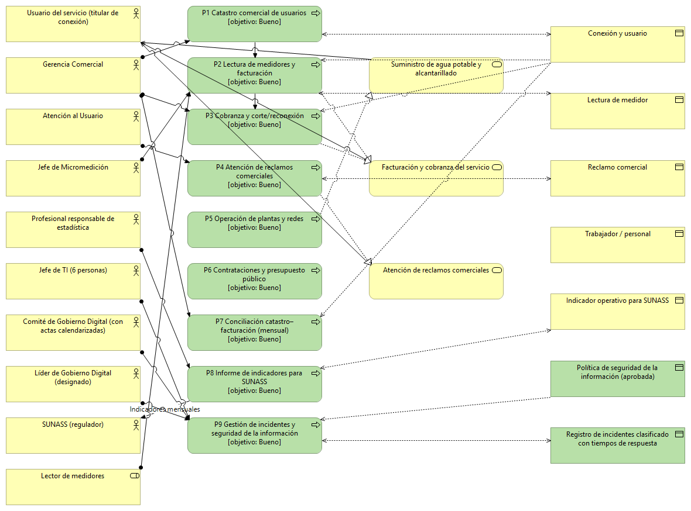
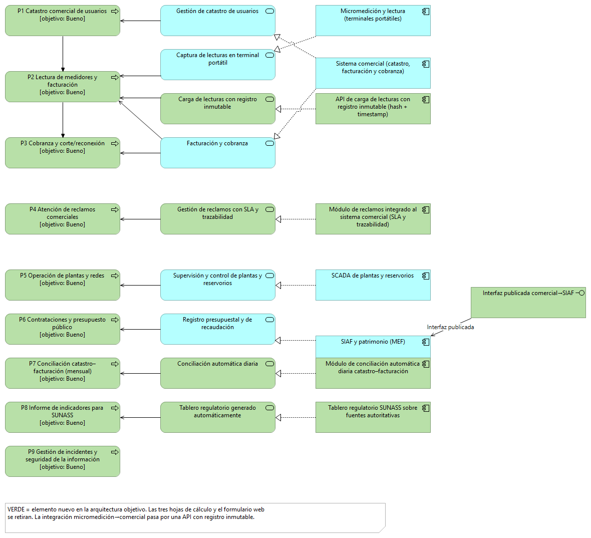
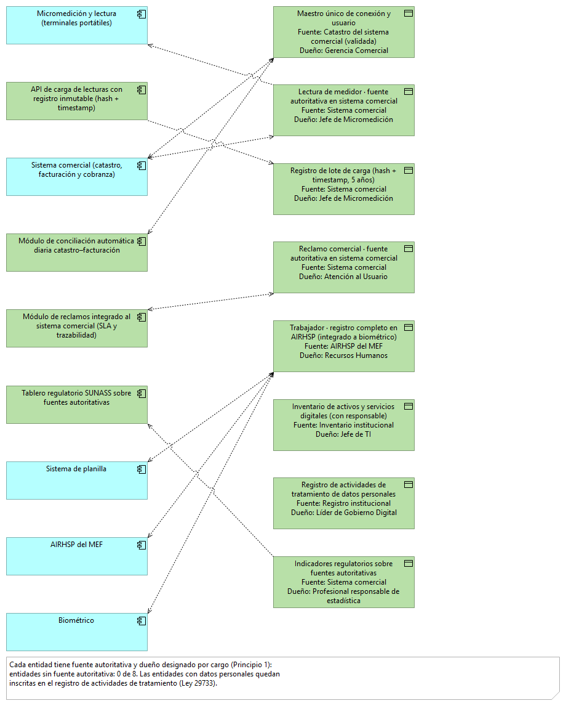
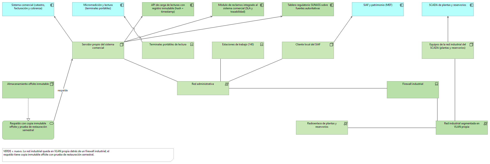
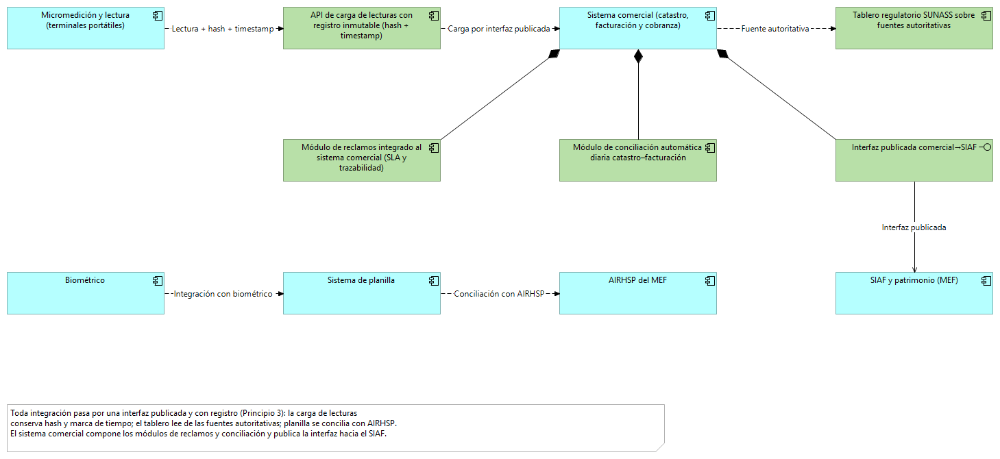

En la arquitectura objetivo, **0 de 8 entidades quedan sin fuente autoritativa** y las tres hojas de cálculo y el formulario web se retiran.

## 5.4 Análisis de brechas

### 5.4.1 Tabla de brechas por capa y tipo

15 brechas: Datos 6 · Aplicación 5 · Tecnología 2 · Negocio 2. Esfuerzo alto 3 · medio 7 · bajo 5. Tabla completa en [`AR03_brechas.csv`](AR03_brechas.csv); salida del programa en [`AR03_brechas_salida.txt`](../evidencias/S10/salidas/AR03_brechas_salida.txt).

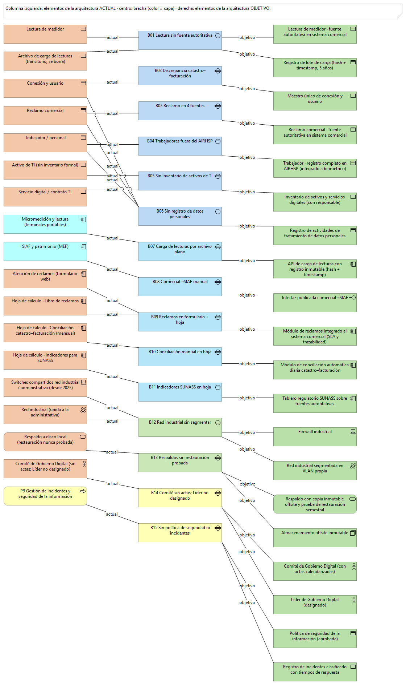

### 5.4.2 Paquetes de trabajo derivados

| Paquete | Brechas | Esfuerzo máx. | Depende de |
|---|---|---|---|
| PT-01 Gobierno del dato maestro | 2 | Alto | — |
| PT-02 Trazabilidad del ciclo comercial | 3 | Alto | PT-01 |
| PT-03 Gestión de reclamos integrada | 2 | Medio | PT-01 |
| PT-04 Segmentación de red industrial | 1 | Alto | — |
| PT-05 Continuidad y respaldo | 1 | Medio | — |
| PT-06 Tablero regulatorio SUNASS | 1 | Medio | PT-01, PT-02, PT-03 |
| PT-07 Cumplimiento de datos personales | 2 | Bajo | PT-01 |
| PT-08 Gobierno digital y seguridad | 3 | Bajo | — |

### 5.4.3 Dependencias y secuencia obligada

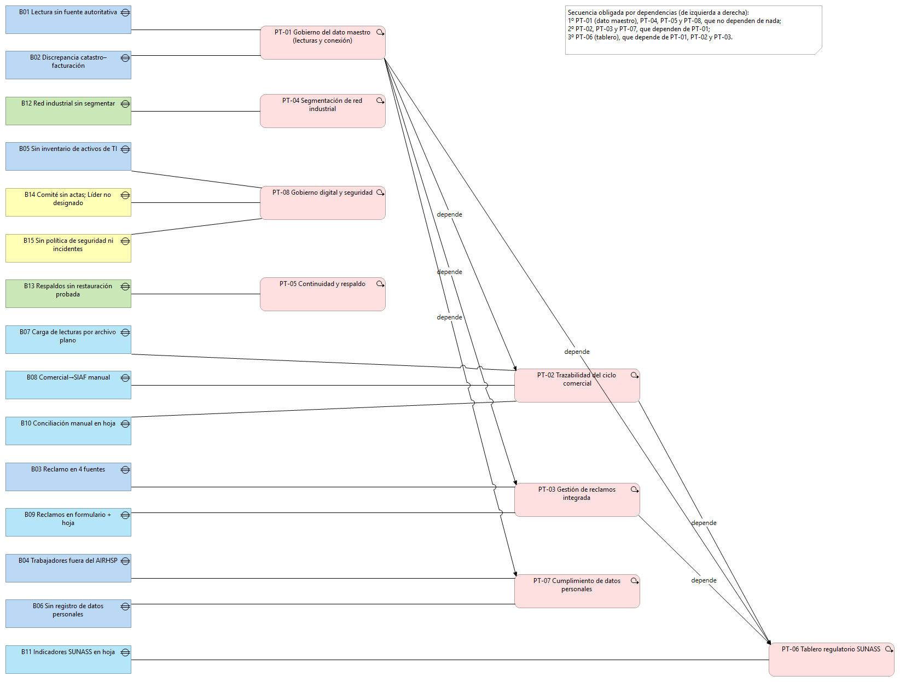

1. PT-01 · 2. PT-04 · 3. PT-08 · 4. PT-05 · 5. PT-02 · 6. PT-03 · 7. PT-07 · 8. PT-06.

**Los paquetes de trabajo son el insumo directo del portafolio (Sección 7.1).**

## Validación (Paso F)

Salida completa en [`validacion_modelo.txt`](../evidencias/S10/salidas/validacion_modelo.txt) (script [`validar_modelo.py`](validar_modelo.py)).

1. **Capas:** 122 elementos revisados, 0 fuera de su capa.
2. **Aplicaciones reales:** las 11 aplicaciones actuales constan en el inventario de la organización.
3. **Brechas trazables:** las 15 brechas se señalan en el modelo actual y en el objetivo.

### Problemas y mejoras

- Las vistas objetivo se derivan de la FICHA, AR01 y AR03. Falta vincularlas con las secciones 2.2 (visión), 3.1.5 (capacidades) y 3.5 (FODA cruzado) del PETI cuando el equipo las cierre.
- P7, P8 y P9 se añadieron al modelo aunque no están en la cadena de valor de la ficha; conviene que la organización confirme el nivel de soporte asignado.
- El nivel de soporte de cada proceso es un juicio del equipo, justificado en la documentación de cada elemento del modelo.
